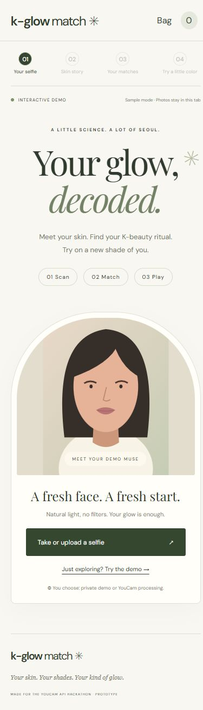
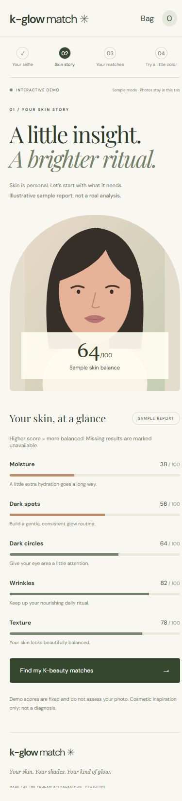
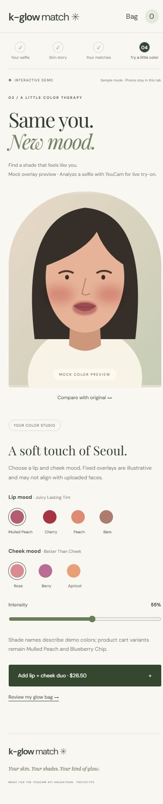

# K-Glow Match

Mobile-first English YouCam hackathon prototype: selfie → skin report → K-beauty matches → lip/blush try-on → demo bag. No accounts, database, payments, or real orders.

Live app: [K-Glow Match](https://k-glow-match.vercel.app). Hosted on Vercel Hobby.

Source repository: https://github.com/Joyleesales/k-glow-match

## Languages and skin age

Choose EN / KO / ES in the header (also available in the bag). English is the default; the choice is saved on the device when browser storage is available. Interface copy, accessible labels, progress and error messages are translated; brand/product names, prices and API parameters stay unchanged.

The report shows skin age beside the existing average score only when the YouCam response includes an explicit numeric `skin_age`. No age is inferred from concern scores or the optional recommendation age range. If no age is returned, the report says so; demo mode has no invented age. Existing API endpoints, requested actions and request bodies are unchanged. Vendor field reference: [YouCam Skin Analysis results](https://docs.perfectcorp.com/reference/ai_skin_analysis).

## Setup

Requires Node 20.19+ or 22.12+. Run `npm install` (or `pnpm install`), copy `.env.example` to `.env`, set `YOUCAM_API_KEY`, then run `npm run dev`. Build: `npm run build`. Preview with API middleware: `npm run preview`.

Secrets are server-only, ignored by Git, and never exposed as `VITE_*`. `YOUCAM_SECRET_KEY` is unused by this integration: current v2 REST uses API Key Bearer authentication.

## Modes

Demo works without keys: fixed sample scores and illustrative CSS makeup overlay. Demo photos remain in the tab. Age is optional, appears only at recommendations (20s / 30s / 40s / 50s+), and reorders concern-matched products using editorial preferences. It never changes scores or blocks navigation. A curated ritual can be added to the bag with one action.

Live: upload a photo, explicitly consent to sending it to YouCam, then choose Analyze with YouCam. Photos are converted to JPEG at max 1000 pixels on the long side, with at least 480 pixels on the short side. Server initializes a File API upload, uploads bytes to its signed URL, starts the task, and polls until complete. Live scores replace mock values; missing scores stay unavailable. Errors never silently fall back to sample results.

After live analysis, choose lip/blush colors and intensity and click Render with YouCam. The rendered image can be compared with the original. Changed colors require a new explicit render; slider changes do not trigger API charges. Live tasks consume account units. Preview colors are approximate mood shades, not certified matches to brand variants.

The app has no persistent photo storage. YouCam processes and retains uploads under its own policies; immediate vendor deletion is not promised. Session references are signed and expire after one hour. Task polling is bounded to about three minutes; individual requests have timeouts.

## APIs

- [Skin AI](https://docs.perfectcorp.com/reference/ai_skin_analysis): `/s2s/v2.0/task/skin-analysis`, SD moisture, age_spot, dark_circle_v2, wrinkle, texture; JSON ui_score output.
- [Makeup VTO](https://docs.perfectcorp.com/reference/makeup_vto/section/overview): `/s2s/v2.0/task/makeup-vto`, lip_color and blush; skin smoothing disabled.
- File upload: `/s2s/v2.0/file`, followed by the returned signed PUT request.

`server/youcam.mjs` implements the adapter, `api/youcam.mjs` exposes it on Vercel, and `vite.config.js` mounts it locally. `src/youcam.js` handles photo preparation/polling; `src/main.jsx` is the flow; `src/catalog.js` holds products; `src/recommendations.js` ranks them.

## Deploy

Vercel: set this folder as project root, Vite framework, build `npm run build`, output `dist`, and configure server environment variable `YOUCAM_API_KEY`. Live mode needs `/api/youcam`; static-only hosting supports demo mode. Netlify is supported by `netlify.toml` and `netlify/functions/youcam.mjs`: set the same server environment variable in Netlify. Keep the prototype access-controlled before broad sharing: it spends the owner's credits and has no durable multi-user quotas.

## Verification

Mock browser walkthrough passed for reports, filters, age-based ordering, color controls, before/after, ritual add, quantities, totals and completion. Production build passes.

Milestone 2 live verification passed using YouCam's public sample photo: authentication, upload, skin task, five parsed scores, makeup task and result image URL. Run `node scripts/verify-live.mjs` from this folder to repeat (uses API units). It prints no keys or signed result URLs. The user's private selfie has not been used. 390px mobile and 1280px desktop browser layouts are checked separately; physical-phone camera capture has not been verified.

## Assets and remaining work

Real product names from [COSRX](https://www.cosrx.com/products/advanced-snail-96-mucin-power-essence), [Beauty of Joseon](https://beautyofjoseon.com), and [rom&nd](https://romand.us). Eight product photos and variant-specific USD reference prices were sourced from their product pages. Prices are a fixed snapshot, not a live quote; checkout is demo-only. Image source URLs, reference variants, and prices are recorded in `product-sources.json` and `ASSET-CREDITS.md`. Product images remain the property of their brands. `node make-assets.mjs` regenerates the older fallback illustrations. Cart variants are Mulled Peach and Blueberry Chip. Google Fonts has system fallbacks. Working screenshots and a vendor public test image are in `screenshots/`.

Milestone 3: product imagery and reference prices updated; responsive layouts and optional age flow verified; final screenshots included. Production is deployed, and both YouCam APIs passed an end-to-end verification through the hosted API using the vendor's public sample. Cosmetic inspiration, not a diagnosis.

## Reviewed screenshots

These screenshots use the app’s illustrated sample mode, not a personal selfie.

